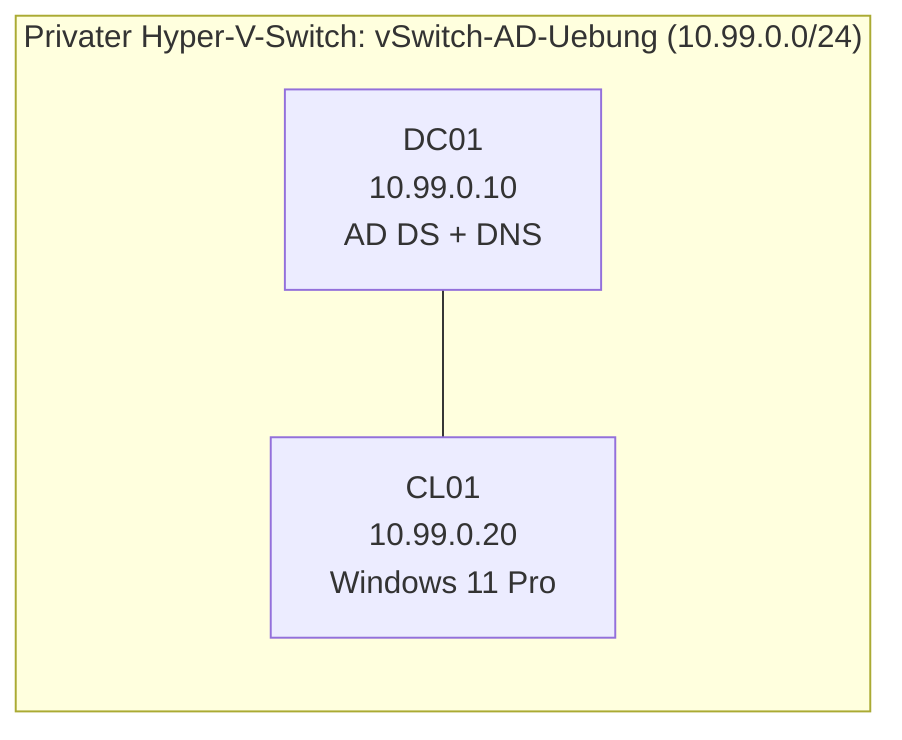
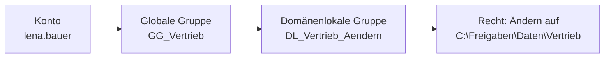

# 01.1 Benutzerverwaltung im Active Directory

| | |
|---|---|
| **Modul** | 01 Benutzerverwaltung |
| **Stufe** | Aufbau |
| **Geschätzte Zeit** | 6 bis 8 Stunden (Schätzung), auf mehrere Tage verteilbar |
| **Werkzeuge** | Hyper-V, Windows Server mit AD DS, Windows 11 Pro, PowerShell 5.1 |
| **Vorwissen** | Grundbegriffe von Windows Server. Active-Directory-Begriffe werden erklärt. |

> [!WARNING]
> **Stand der Prüfung: Entwurf.** Die Befehle sind gegen die Dokumentation von Microsoft geprüft, soweit unter „Quellen“ genannt. Die drei Skripte wurden mit PowerShell 7.4.6 auf Syntaxfehler geprüft und gegen eine simulierte Verzeichnisabfrage getestet (erster Lauf: 11 angelegt, 2 Fehler; zweiter Lauf: 11 übersprungen, 2 Fehler). **In einem echten Active Directory wurde nichts ausgeführt.** Alle Ausgaben in dieser Übung sind sinngemäß und nicht bestätigt. Stellen, die besonders unsicher sind, sind mit *nicht bestätigt* markiert.

## Lernziele

Nach dieser Übung kannst du

- eine Organisationsstruktur im Active Directory planen und anlegen,
- Benutzer einzeln und per CSV-Datei anlegen, ohne Duplikate und ohne Klartextkennwörter im Skript,
- typische Alltagsaufgaben erledigen: Kennwort zurücksetzen, Konto entsperren, Austritt, Namensänderung, inaktive Konten finden,
- einer Helpdesk-Gruppe genau die Rechte geben, die sie braucht, und nicht mehr,
- Zugriffsrechte über Gruppen vergeben (A-G-DL-P) und prüfen, wer was sieht,
- in der Ereignisanzeige nachvollziehen, wer wann was geändert hat.

## Voraussetzungen

- Ein Hyper-V-Host mit genug Platz für zwei VMs (je 2 bis 4 GB RAM reichen für die Übung).
- ISO-Dateien für einen Windows Server mit Desktopdarstellung und für Windows 11 Pro (eigene Lizenzen oder Testversionen).
- Grundkenntnisse in PowerShell (Befehl, Parameter, Pipeline).
- **Wichtig:** Die Übung läuft in einer **eigenen Test-Domäne** auf einem **privaten Hyper-V-Switch ohne Verbindung nach außen**. Sie berührt weder ein bestehendes Active Directory noch das Heimnetz.

## Grundbegriffe

| Begriff | Bedeutung |
|---|---|
| **OU** (Organizational Unit) | Ordner im Verzeichnis. Hier liegen Benutzer, Gruppen, Computer. An OUs hängen Gruppenrichtlinien und Delegierungen. |
| **Name / CN** | Der Objektname im Verzeichnis (`CN=Lena Bauer`). Muss nur innerhalb einer OU eindeutig sein. |
| **sAMAccountName** | Der klassische Anmeldename (`lena.bauer`). Maximal 20 Zeichen, domänenweit eindeutig. |
| **UPN** (UserPrincipalName) | Anmeldename im E-Mail-Stil (`lena.bauer@alpenwerk.example`). Muss im Wald eindeutig sein. |
| **DisplayName** | Anzeigename in Adresslisten. |
| **employeeID** | Attribut für die Personalnummer. In dieser Übung der eindeutige Schlüssel einer Person. |
| **SID** | Eindeutige, unveränderliche Kennung eines Kontos. Rechte hängen an der SID, nicht am Namen. |
| **Gruppenbereich** | *Global* (Konten der eigenen Domäne), *Domänenlokal* (für Rechte auf Ressourcen der Domäne). |
| **A-G-DL-P** | Konto → Globale Gruppe (Rolle) → Domänenlokale Gruppe (Berechtigung) → Permission (Recht auf dem Ordner). |
| **Delegierung** | Bestimmte Rechte auf einer OU an eine Gruppe übertragen, ohne sie zum Domänenadministrator zu machen. |
| **ABE** (Access-Based Enumeration) | Benutzer sehen in einer Freigabe nur die Ordner, auf die sie Rechte haben. |
| **lastLogonTimestamp** | Zeitpunkt der letzten Anmeldung, der nur grob (alle 9 bis 14 Tage) aktualisiert wird. |

## Testumgebung und Adressplan

Zwei VMs in einem privaten Netz. Die Namen sind frei gewählt. Die Domäne `alpenwerk.example` ist erfunden (`.example` ist für Beispiele reserviert).

<!-- tikz:topologie -->


| Gerät | Rolle | Adresse | DNS-Server |
|---|---|---|---|
| DC01 | Domänencontroller, DNS | 10.99.0.10/24 | 10.99.0.10 (er selbst) |
| CL01 | Client mit Verwaltungstools, Test-Dateiserver | 10.99.0.20/24 | 10.99.0.10 |

Kein Standardgateway: Das Netz hat keinen Ausgang. Es gibt keinen DHCP-Server, die Adressen sind fest vergeben.

| Angabe | Wert |
|---|---|
| Domäne (DNS) | `alpenwerk.example` |
| NetBIOS-Name | `ALPENWERK` |
| Oberste OU | `Alpenwerk` |
| Basis-DN | `DC=alpenwerk,DC=example` |

## Aufgabe

Jeder Schritt steht auf zwei Wegen: grafisch (GUI) und per PowerShell. Wo es nur einen Weg gibt, steht das dabei. PowerShell-Befehle werden, wenn nichts anderes steht, auf **DC01** in einer PowerShell als Administrator eingegeben.

### Teil 0: Testumgebung aufbauen

**0.1 Privaten Switch anlegen und die VMs anschließen**

- **GUI:** Hyper-V-Manager → *Manager für virtuelle Switches* → *Neuer virtueller Netzwerkswitch* → Typ *Privat* → Name `vSwitch-AD-Uebung`. Bei beiden VMs unter *Einstellungen* → *Netzwerkadapter* diesen Switch wählen.
- **PowerShell** (auf dem Hyper-V-Host):

```powershell
New-VMSwitch -Name 'vSwitch-AD-Uebung' -SwitchType Private
Connect-VMNetworkAdapter -VMName 'DC01','CL01' -SwitchName 'vSwitch-AD-Uebung'
```

**0.2 Feste Adressen vergeben**

- **GUI:** Auf jeder VM *Netzwerkverbindungen* → Adapter → *Eigenschaften* → *Internetprotokoll Version 4* → Adresse, Subnetzmaske `255.255.255.0` und DNS-Server nach Adressplan eintragen. Gateway leer lassen.
- **PowerShell** (auf DC01, der Adaptername kann abweichen, mit `Get-NetAdapter` nachsehen):

```powershell
New-NetIPAddress -InterfaceAlias 'Ethernet' -IPAddress 10.99.0.10 -PrefixLength 24
Set-DnsClientServerAddress -InterfaceAlias 'Ethernet' -ServerAddresses 10.99.0.10
```

Auf CL01 entsprechend mit `10.99.0.20` und DNS-Server `10.99.0.10`.

**0.3 Domänencontroller einrichten (DC01)**

- **GUI:** Server-Manager → *Verwalten* → *Rollen und Features hinzufügen* → Rolle *Active Directory-Domänendienste*. Danach oben die Flagge → *Server zu einem Domänencontroller heraufstufen* → *Neue Gesamtstruktur hinzufügen* → Stammdomäne `alpenwerk.example`. DSRM-Kennwort festlegen, Assistent abschließen, Neustart.
- **PowerShell:**

```powershell
Install-WindowsFeature AD-Domain-Services -IncludeManagementTools
Install-ADDSForest -DomainName 'alpenwerk.example' -DomainNetbiosName 'ALPENWERK' -InstallDns
```

Der Befehl fragt das DSRM-Kennwort ab und startet den Server neu.

**0.4 Client in die Domäne aufnehmen (CL01)**

- **GUI:** *Einstellungen* → *System* → *Info* → *Domäne oder Arbeitsgruppe* → *Ändern* → Domäne `alpenwerk.example`. Mit dem Domänenadministrator anmelden, neu starten.
- **PowerShell** (als lokaler Administrator auf CL01):

```powershell
Add-Computer -DomainName 'alpenwerk.example' -Credential 'ALPENWERK\Administrator' -Restart
```

**0.5 Verwaltungstools auf CL01 installieren**

- **GUI:** *Einstellungen* → *System* → *Optionale Features* → *Feature hinzufügen* → *RSAT: Active Directory Domain Services and Lightweight Directory Services Tools*.
- **PowerShell** (als Domänenadministrator auf CL01):

```powershell
Add-WindowsCapability -Online -Name 'Rsat.ActiveDirectory.DS-LDS.Tools~~~~0.0.1.0'
```

**0.6 Übungsdateien auf DC01 bereitstellen**

Kopiere die Dateien `01.1-ou-struktur-anlegen.ps1`, `01.1-benutzer-anlegen.ps1`, `01.1-aufraeumen.ps1` und `01.1-mitarbeiter.csv` nach `C:\Uebung` auf DC01 (zum Beispiel per erweiterter Sitzung im Hyper-V-Manager oder über die Zwischenablage). Die Skripte sind mit UTF-8 (mit BOM) gespeichert, damit Umlaute in der Windows PowerShell 5.1 richtig gelesen werden. Speichere sie beim Kopieren in derselben Kodierung.

> [!NOTE]
> Skripte aus dem Internet laufen nur, wenn die Ausführungsrichtlinie es erlaubt. In der Test-Domäne reicht für die laufende Sitzung: `Set-ExecutionPolicy -Scope Process -ExecutionPolicy RemoteSigned`. Bei Dateien, die als aus dem Internet geladen markiert sind, hilft `Unblock-File`.

### Teil 1: Benutzer anlegen

**1. OU-Struktur planen und anlegen**

Zielstruktur:

```text
Alpenwerk
├── Benutzer
│   ├── Vertrieb
│   ├── Produktion
│   ├── IT
│   └── Ehemalige
├── Gruppen
└── Computer
```

- **GUI:** Server-Manager → *Tools* → *Active Directory-Benutzer und -Computer*. Rechtsklick auf die Domäne → *Neu* → *Organisationseinheit* und die OUs der Reihe nach anlegen. Das Häkchen *Container vor zufälligem Löschen schützen* bleibt gesetzt.
- **PowerShell:** Erst simulieren, dann ausführen:

```powershell
cd C:\Uebung
.\01.1-ou-struktur-anlegen.ps1 -WhatIf
.\01.1-ou-struktur-anlegen.ps1
```

Sinngemäße Ausgabe: je OU eine Zeile `angelegt: OU=...`. Ein zweiter Lauf meldet `vorhanden:` und ändert nichts.

**2. Einen Benutzer von Hand anlegen**

Lege `Max Probe` in der OU `Vertrieb` an. Anmeldename `max.probe`, Kennwortänderung bei der ersten Anmeldung.

- **GUI:** Rechtsklick auf die OU `Vertrieb` → *Neu* → *Benutzer*. Vorname, Nachname, Benutzeranmeldename `max.probe` eintragen, Kennwort setzen, Häkchen *Benutzer muss Kennwort bei der nächsten Anmeldung ändern* lassen.
- **PowerShell:**

```powershell
New-ADUser -Name 'Max Probe' -GivenName 'Max' -Surname 'Probe' -DisplayName 'Max Probe' `
    -SamAccountName 'max.probe' -UserPrincipalName 'max.probe@alpenwerk.example' `
    -Path 'OU=Vertrieb,OU=Benutzer,OU=Alpenwerk,DC=alpenwerk,DC=example' `
    -AccountPassword (Read-Host -Prompt 'Startkennwort' -AsSecureString) `
    -Enabled $true -ChangePasswordAtLogon $true
```

Sieh dir das Ergebnis an:

```powershell
Get-ADUser -Identity 'max.probe' -Properties DisplayName, PasswordLastSet |
    Format-List Name, SamAccountName, UserPrincipalName, DisplayName, DistinguishedName, Enabled, PasswordLastSet
```

Ist `PasswordLastSet` leer, muss das Kennwort bei der nächsten Anmeldung geändert werden (sinngemäß, nicht bestätigt).

Welche Kennwortregeln gelten? Das zeigt:

```powershell
Get-ADDefaultDomainPasswordPolicy
```

Wähle für die Übung ein Kennwort, das diese Regeln erfüllt. Wenn die Anlage mit einer Meldung zur Kennwortrichtlinie scheitert, liegt es fast immer daran.

**3. Viele Benutzer per CSV anlegen**

- **GUI:** Entfällt. *Active Directory-Benutzer und -Computer* kann keine CSV-Datei importieren, nur einzeln anlegen.
- **PowerShell:** Sieh dir zuerst `01.1-mitarbeiter.csv` an: 13 Zeilen mit Personalnummer, Name, Abteilung und Position. Einige Zeilen sind absichtlich schwierig (Umlaute, zwei Personen namens Anna Huber, ein sehr langer Name, eine unbekannte Abteilung, ein fehlender Nachname). Dann:

```powershell
.\01.1-benutzer-anlegen.ps1 -CsvPath .\01.1-mitarbeiter.csv -WhatIf
.\01.1-benutzer-anlegen.ps1 -CsvPath .\01.1-mitarbeiter.csv
```

Der zweite Aufruf fragt einmal nach einem Startkennwort für alle Konten (wieder eines, das die Regeln erfüllt). Erwartetes Ergebnis (sinngemäß): 11 Konten angelegt, 2 Fehler (Zeile 12: OU `Marketing` fehlt, Zeile 13: Nachname fehlt). Das Protokoll liegt als `benutzer-anlegen-protokoll.csv` neben dem Skript und enthält kein Kennwort.

**4. Zweiter Lauf und Fehler beheben**

- Starte den Aufruf aus Schritt 3 ein zweites Mal. Erwartung: alle 11 Konten werden **übersprungen**, nichts wird doppelt angelegt.
- **Zeile 12 (Marketing):** Lege die OU `Marketing` unter `Benutzer` an (GUI wie in Schritt 1, oder `New-ADOrganizationalUnit -Name 'Marketing' -Path 'OU=Benutzer,OU=Alpenwerk,DC=alpenwerk,DC=example'`).
- **Zeile 13 (Nachname fehlt):** Trage in der CSV den Nachnamen `Neumann` ein.
- Starte das Skript ein drittes Mal. Erwartung: genau 2 Konten werden neu angelegt, 11 übersprungen.

**5. Ergebnis prüfen und im Ereignisprotokoll nachsehen**

- **GUI:** In *Active Directory-Benutzer und -Computer* die OUs öffnen. In der Ereignisanzeige: *Windows-Protokolle* → *Sicherheit* → *Aktuelles Protokoll filtern* → Ereignis-ID `4720`.
- **PowerShell:**

```powershell
Get-ADUser -Filter * -SearchBase 'OU=Benutzer,OU=Alpenwerk,DC=alpenwerk,DC=example' -Properties Department, EmployeeID, Title |
    Sort-Object Department, SamAccountName |
    Format-Table SamAccountName, Name, Department, EmployeeID, Title -AutoSize

Get-WinEvent -FilterHashtable @{ LogName = 'Security'; Id = 4720 } -MaxEvents 5 |
    Select-Object TimeCreated, Message
```

Im Ereignis steht, **wer** das Konto angelegt hat (Abschnitt *Subject*) und **welches** Konto entstanden ist (*New Account*). Erscheinen keine Ereignisse, ist die Überwachung nicht eingeschaltet. Prüfe dann in der *Default Domain Controllers Policy* unter *Erweiterte Überwachungsrichtlinienkonfiguration* → *Kontoverwaltung* die Richtlinie *Benutzerkontenverwaltung überwachen* (Erfolgreich und Fehlgeschlagen).

### Teil 2: Alltag

**6. Sperrrichtlinie für die Übung einstellen**

Ohne Sperrrichtlinie wird kein Konto je gesperrt. Für den Test genügt eine kurze Sperrzeit.

- **GUI:** *Gruppenrichtlinienverwaltung* → *Default Domain Policy* → *Bearbeiten* → *Computerkonfiguration* → *Richtlinien* → *Windows-Einstellungen* → *Sicherheitseinstellungen* → *Kontorichtlinien* → *Kontosperrungsrichtlinien*. Schwellenwert 3, Sperrdauer und Zurücksetzungsdauer je 30 Minuten.
- **PowerShell:**

```powershell
Set-ADDefaultDomainPasswordPolicy -Identity 'alpenwerk.example' `
    -LockoutThreshold 3 -LockoutDuration 00:30:00 -LockoutObservationWindow 00:30:00
Get-ADDefaultDomainPasswordPolicy
```

**7. Helpdesk-Gruppe anlegen**

Tobias Fischer (`tobias.fischer`) macht den Helpdesk-Dienst.

- **GUI:** Rechtsklick auf die OU `Gruppen` → *Neu* → *Gruppe* → Name `GG_Helpdesk`, Bereich *Global*, Typ *Sicherheit*. Danach Eigenschaften → *Mitglieder* → `tobias.fischer` hinzufügen.
- **PowerShell:**

```powershell
New-ADGroup -Name 'GG_Helpdesk' -GroupScope Global -GroupCategory Security `
    -Path 'OU=Gruppen,OU=Alpenwerk,DC=alpenwerk,DC=example'
Add-ADGroupMember -Identity 'GG_Helpdesk' -Members 'tobias.fischer'
```

**8. Dem Helpdesk das Zurücksetzen von Kennwörtern erlauben**

Die Gruppe soll in der OU `Benutzer` Kennwörter zurücksetzen dürfen, sonst nichts.

- **GUI:** Rechtsklick auf die OU `Benutzer` → *Objektverwaltung zuweisen* (englisch *Delegate Control*) → *Weiter* → *Hinzufügen* → `GG_Helpdesk` → *Weiter* → Aufgabe *Benutzerkennwörter zurücksetzen und Kennwortänderung bei der nächsten Anmeldung erzwingen* → *Fertig stellen*.
- **PowerShell:** (*nicht bestätigt*, Syntax von `dsacls` für dieses Recht nicht in der Dokumentation nachgeprüft)

```powershell
dsacls "OU=Benutzer,OU=Alpenwerk,DC=alpenwerk,DC=example" /I:S /G "ALPENWERK\GG_Helpdesk:CA;Reset Password;user"
```

**9. Als Helpdesk anmelden und Kennwort zurücksetzen (Alltagsfall A)**

Lena Bauer hat ihr Kennwort vergessen.

- Melde dich auf **CL01** als `ALPENWERK\tobias.fischer` an. Beim ersten Anmelden verlangt Windows ein neues Kennwort (das ist die Einstellung aus Schritt 3).
- **GUI:** *Windows-Tools* → *Active Directory-Benutzer und -Computer* → `lena.bauer` suchen → Rechtsklick → *Kennwort zurücksetzen* → neues Kennwort, Häkchen *Benutzer muss Kennwort bei der nächsten Anmeldung ändern*.
- **PowerShell:**

```powershell
Set-ADAccountPassword -Identity 'lena.bauer' -Reset -NewPassword (Read-Host -Prompt 'Neues Kennwort' -AsSecureString)
Set-ADUser -Identity 'lena.bauer' -ChangePasswordAtLogon $true
```

Prüfe zwei Dinge: Tobias darf das Kennwort **zurücksetzen**. Er darf **keinen neuen Benutzer anlegen** (Rechtsklick auf die OU → *Neu* → *Benutzer* meldet einen Zugriffsfehler). Auf DC01 findest du das Ereignis `4724`.

**10. Konto sperren und entsperren (Alltagsfall B)**

- Melde dich auf CL01 am Anmeldebildschirm mit *Anderer Benutzer* als `ALPENWERK\peter.wagner` mit **falschem** Kennwort drei Mal an. Das Konto ist danach gesperrt.
- **GUI** (als Tobias auf CL01): Konto suchen → Rechtsklick → *Eigenschaften* → *Konto* → Häkchen *Konto entsperren*.
- **PowerShell:**

```powershell
Search-ADAccount -LockedOut -UsersOnly | Select-Object Name, SamAccountName, LockedOut
Unlock-ADAccount -Identity 'peter.wagner'
```

Erwartung (*nicht bestätigt*): Das Entsperren **scheitert** mit einem Zugriffsfehler, weil in Schritt 8 nur das Zurücksetzen von Kennwörtern übertragen wurde. Beheben:

- **GUI:** Auf DC01 den Assistenten *Objektverwaltung zuweisen* erneut auf der OU `Benutzer` für `GG_Helpdesk` starten → *Benutzerdefinierte Aufgabe erstellen* → *Nur folgende Objekte im Ordner*: Benutzerobjekte → Berechtigungen *Eigenschaftsspezifisch* → `lockoutTime` lesen und schreiben (englisch *Read lockoutTime* und *Write lockoutTime*).
- **PowerShell:** Entfällt, weil für diesen Teil der Befehl nicht geprüft ist.

Versuche das Entsperren danach erneut. Auf DC01 stehen die Ereignisse `4740` (gesperrt) und `4767` (entsperrt).

**11. Austritt eines Mitarbeiters (Alltagsfall C)**

Ivana Horvat (`ivana.horvat`) verlässt die Firma in 30 Tagen. Das Konto wird nicht gelöscht, sondern aufbewahrt.

- **GUI:** Rechtsklick auf das Konto → *Konto deaktivieren*. Eigenschaften → Reiter *Konto* → *Läuft ab am* → Datum setzen. Eigenschaften → *Beschreibung* eintragen. Konto in die OU `Ehemalige` ziehen.
- **PowerShell:**

```powershell
$konto = Get-ADUser -Identity 'ivana.horvat'
Disable-ADAccount -Identity $konto
Set-ADAccountExpiration -Identity $konto -DateTime (Get-Date).AddDays(30)
Set-ADUser -Identity $konto -Description 'Austritt, Personalnummer 1010'
Move-ADObject -Identity $konto.DistinguishedName -TargetPath 'OU=Ehemalige,OU=Benutzer,OU=Alpenwerk,DC=alpenwerk,DC=example'
```

Prüfe mit `Get-ADUser -Identity 'ivana.horvat' -Properties AccountExpirationDate | Select-Object Name, Enabled, AccountExpirationDate, DistinguishedName`. Ereignis auf DC01: `4725` (Konto deaktiviert).

**12. Namensänderung (Alltagsfall D)**

Katharina Lang-Kurz (`katharina.lang-kurz`) heißt künftig Katharina Hofer.

- **GUI:** Rechtsklick auf das Konto → *Umbenennen* → neuen Namen eintragen. Im Assistenten Nachname, Anzeigename und Benutzeranmeldenamen (beide) anpassen.
- **PowerShell:** Zwei Schritte, weil die Attribute und der Objektname getrennt gepflegt werden:

```powershell
$konto = Get-ADUser -Identity 'katharina.lang-kurz'
Set-ADUser -Identity $konto -Surname 'Hofer' -DisplayName 'Katharina Hofer' `
    -SamAccountName 'katharina.hofer' -UserPrincipalName 'katharina.hofer@alpenwerk.example'
Rename-ADObject -Identity $konto.DistinguishedName -NewName 'Katharina Hofer'
```

Starte danach `.\01.1-benutzer-anlegen.ps1` noch einmal. Erwartung: Katharina wird **nicht** neu angelegt, sondern übersprungen, weil die Personalnummer gleich geblieben ist. Ereignisse: `4738` und `4781`.

**13. Inaktive Konten finden (Alltagsfall E)**

- **GUI:** *Active Directory-Benutzer und -Computer* → *Gespeicherte Abfragen* → neue Abfrage → *Benutzerdefinierte Suche* → *Erweitert*. Das ist umständlich, daher meist PowerShell.
- **PowerShell:**

```powershell
Search-ADAccount -AccountInactive -TimeSpan 30.00:00:00 -UsersOnly | Select-Object Name, SamAccountName, LastLogonDate
Get-ADUser -Filter * -Properties LastLogonDate | Select-Object SamAccountName, LastLogonDate | Sort-Object LastLogonDate
```

In einer frisch aufgebauten Test-Domäne ist die Liste wenig aussagekräftig, weil sich kaum jemand angemeldet hat. Notiere, welche Konten erscheinen und welche nicht (Ausgabe *nicht bestätigt*), und lies im Hintergrund nach, warum die Zeitangabe nur grob stimmt.

### Teil 3: Rechte über Gruppen vergeben (A-G-DL-P)

Ziel: Auf CL01 gibt es die Freigabe `Daten` mit je einem Ordner pro Abteilung. Jeder sieht und bearbeitet nur seinen Ordner. IT darf zusätzlich im Ordner `Vertrieb` lesen.

<!-- tikz:agdlp -->


**14. Gruppen anlegen**

Globale Gruppen bilden die Rolle (Abteilung) ab, domänenlokale Gruppen die Berechtigung.

- **GUI:** Wie in Schritt 7. Globale Gruppen: `GG_Vertrieb`, `GG_Produktion`, `GG_IT`. Domänenlokale Gruppen (Bereich *Domänenlokal*): `DL_Vertrieb_Aendern`, `DL_Vertrieb_Lesen`, `DL_Produktion_Aendern`, `DL_IT_Aendern`.
- **PowerShell:**

```powershell
$gruppen = 'OU=Gruppen,OU=Alpenwerk,DC=alpenwerk,DC=example'
foreach ($abt in 'Vertrieb', 'Produktion', 'IT') {
    New-ADGroup -Name "GG_$abt" -GroupScope Global -GroupCategory Security -Path $gruppen
    New-ADGroup -Name "DL_${abt}_Aendern" -GroupScope DomainLocal -GroupCategory Security -Path $gruppen
}
New-ADGroup -Name 'DL_Vertrieb_Lesen' -GroupScope DomainLocal -GroupCategory Security -Path $gruppen
```

**15. Mitarbeiter in die Rollengruppen aufnehmen**

- **GUI:** Gruppe öffnen → *Mitglieder* → *Hinzufügen*. (Bei vielen Konten umständlich.)
- **PowerShell:** Die Mitglieder kommen aus der jeweiligen Abteilungs-OU:

```powershell
foreach ($abt in 'Vertrieb', 'Produktion', 'IT') {
    $konten = Get-ADUser -Filter * -SearchBase "OU=$abt,OU=Benutzer,OU=Alpenwerk,DC=alpenwerk,DC=example"
    Add-ADGroupMember -Identity "GG_$abt" -Members $konten
}
Get-ADGroupMember -Identity 'GG_Vertrieb' | Select-Object SamAccountName
```

Beachte: Ivana Horvat liegt in `Ehemalige` und ist deshalb **nicht** Mitglied.

**16. Gruppen verschachteln**

- **GUI:** Domänenlokale Gruppe öffnen → *Mitglieder* → die globale Gruppe hinzufügen.
- **PowerShell:**

```powershell
foreach ($abt in 'Vertrieb', 'Produktion', 'IT') {
    Add-ADGroupMember -Identity "DL_${abt}_Aendern" -Members "GG_$abt"
}
Add-ADGroupMember -Identity 'DL_Vertrieb_Lesen' -Members 'GG_IT'
```

**17. Ordner, Rechte und Freigabe auf CL01 anlegen**

Melde dich auf CL01 als Domänenadministrator an. Die Gruppen müssen auf CL01 sichtbar sein (RSAT ist installiert).

- **GUI:** Ordner `C:\Freigaben\Daten` mit den Unterordnern `Vertrieb`, `Produktion`, `IT` anlegen. Je Ordner: Eigenschaften → *Sicherheit* → *Erweitert* → *Vererbung deaktivieren* (vererbte Rechte in explizite umwandeln) → nicht benötigte Einträge wie `Benutzer` entfernen → Gruppen und Rechte nach Tabelle eintragen. Freigabe: Eigenschaften → *Freigabe* → *Erweiterte Freigabe* → Name `Daten`, Berechtigungen für *Jeder* auf *Vollzugriff*. Die Option *Zugriffsbasierte Aufzählung* hat in der Clientoberfläche keinen erkennbaren Platz (*nicht bestätigt*); der Server-Manager bietet sie bei Freigaben auf Servern an.
- **PowerShell:**

```powershell
$basis = 'C:\Freigaben\Daten'
New-Item -ItemType Directory -Path "$basis\Vertrieb", "$basis\Produktion", "$basis\IT" -Force | Out-Null

# Hauptordner: Administratoren und SYSTEM voll, angemeldete Benutzer dürfen nur den Ordner selbst auflisten
icacls $basis /inheritance:r
icacls $basis /grant '*S-1-5-32-544:(OI)(CI)F' '*S-1-5-18:(OI)(CI)F' '*S-1-5-11:(RX)'

# Unterordner: Rechte nur über die domänenlokalen Gruppen
foreach ($abt in 'Vertrieb', 'Produktion', 'IT') {
    icacls "$basis\$abt" /inheritance:r
    icacls "$basis\$abt" /grant '*S-1-5-32-544:(OI)(CI)F' '*S-1-5-18:(OI)(CI)F' "ALPENWERK\DL_${abt}_Aendern:(OI)(CI)M"
}
icacls "$basis\Vertrieb" /grant 'ALPENWERK\DL_Vertrieb_Lesen:(OI)(CI)RX'

# Freigabe mit Access-Based Enumeration
New-SmbShare -Name 'Daten' -Path $basis -FolderEnumerationMode AccessBased -FullAccess 'Jeder'
```

`Jeder` ist der Name der Gruppe auf einem deutschen Windows (englisch `Everyone`). Die Share-Berechtigung bleibt offen, die Einschränkung geschieht über die Ordnerrechte.

| Ordner | Wer | Recht |
|---|---|---|
| `Daten` (nur der Ordner) | Angemeldete Benutzer | Lesen und Auflisten |
| `Vertrieb` | `DL_Vertrieb_Aendern` (enthält `GG_Vertrieb`) | Ändern |
| `Vertrieb` | `DL_Vertrieb_Lesen` (enthält `GG_IT`) | Lesen |
| `Produktion` | `DL_Produktion_Aendern` (enthält `GG_Produktion`) | Ändern |
| `IT` | `DL_IT_Aendern` (enthält `GG_IT`) | Ändern |

**18. Prüfen, wer was sieht**

Melde dich auf CL01 nacheinander als `lena.bauer`, `tobias.fischer` und `juergen.mueller` an (beim ersten Mal wird ein neues Kennwort verlangt) und öffne `\\CL01\Daten`.

| Benutzer | Sichtbare Ordner | Darf schreiben in |
|---|---|---|
| `lena.bauer` (Vertrieb) | `Vertrieb` | `Vertrieb` |
| `tobias.fischer` (IT) | `IT`, `Vertrieb` | `IT` (in `Vertrieb` nur lesen) |
| `juergen.mueller` (Produktion) | `Produktion` | `Produktion` |

- **GUI:** Ordner → Eigenschaften → *Sicherheit* → *Erweitert* → Reiter *Effektiver Zugriff* → *Benutzer auswählen*. Das Werkzeug rechnet die verschachtelten Gruppen mit ein.
- **PowerShell:**

```powershell
whoami /groups
icacls C:\Freigaben\Daten\Vertrieb
Get-SmbShare -Name 'Daten' | Select-Object Name, Path, FolderEnumerationMode
```

**19. Mitarbeiterwechsel (Alltagsfall F)**

Mehmet Yilmaz (`mehmet.yilmaz`) wechselt von der Produktion in die IT.

- **GUI:** Konto in die OU `IT` ziehen. In seinen Eigenschaften die Abteilung ändern. Aus `GG_Produktion` entfernen, in `GG_IT` aufnehmen.
- **PowerShell:**

```powershell
$konto = Get-ADUser -Identity 'mehmet.yilmaz'
Move-ADObject -Identity $konto.DistinguishedName -TargetPath 'OU=IT,OU=Benutzer,OU=Alpenwerk,DC=alpenwerk,DC=example'
Set-ADUser -Identity 'mehmet.yilmaz' -Department 'IT'
Remove-ADGroupMember -Identity 'GG_Produktion' -Members 'mehmet.yilmaz' -Confirm:$false
Add-ADGroupMember -Identity 'GG_IT' -Members 'mehmet.yilmaz'
```

Melde dich auf CL01 als Mehmet an, rufe `whoami /groups` auf und öffne `\\CL01\Daten`. Melde dich danach ab, wieder an und vergleiche.

**20. Aufräumen**

Nach der Übung kannst du die Test-Domäne einfach löschen (VMs entfernen). Möchtest du nur die Übungs-OU entfernen:

```powershell
cd C:\Uebung
.\01.1-aufraeumen.ps1 -WhatIf
.\01.1-aufraeumen.ps1
```

Das Skript bricht ab, wenn die Domäne nicht `alpenwerk.example` heißt. Freigabe und Ordner auf CL01 bleiben stehen: `Remove-SmbShare -Name 'Daten' -Force` und den Ordner `C:\Freigaben` von Hand löschen.

## Hintergrund: Was passiert im Verzeichnis?

### Ein Konto hat mehrere Namen

Ein Benutzer ist ein Objekt im Verzeichnis mit vielen Attributen. Mehrere davon sehen aus wie „der Name“, haben aber verschiedene Aufgaben: Der **CN** ist der Objektname und gehört zum Pfad (`CN=Lena Bauer,OU=Vertrieb,...`). Er muss nur in seiner OU eindeutig sein. Der **sAMAccountName** ist der klassische Anmeldename (`ALPENWERK\lena.bauer`) und hat höchstens 20 Zeichen. Der **UPN** ist die moderne Form (`lena.bauer@alpenwerk.example`). Der **DisplayName** erscheint in Listen. Rechte hängen an keinem dieser Namen, sondern an der **SID**. Deshalb bleiben Zugriffsrechte erhalten, wenn jemand umbenannt wird (Schritt 12).

Das Skript prüft nicht nur auf den Anmeldenamen, sondern nimmt die **Personalnummer** als Schlüssel. Zwei Personen mit dem Namen Anna Huber sind zwei Konten (`anna.huber`, `anna.huber2`), dieselbe Person wird auch nach einer Heirat nicht doppelt angelegt.

### Warum ein Skript statt Klicken?

Von Hand schleichen sich Tippfehler und fehlende Felder ein. Ein Skript macht es jedes Mal gleich, protokolliert und lässt sich mit `-WhatIf` ohne Folgen testen. Ein **idempotentes** Skript kann man beliebig oft starten: Was schon da ist, wird übersprungen. Das Startkennwort wird zur Laufzeit abgefragt und liegt weder im Skript noch im Protokoll. `-ChangePasswordAtLogon` setzt das Attribut `pwdLastSet` auf 0, daher muss die Person beim ersten Anmelden ein neues Kennwort wählen. In der Praxis würde man jedem Konto ein eigenes Einmalkennwort geben und es auf einem sicheren Weg übermitteln. Ein gemeinsames Startkennwort ist hier eine Vereinfachung für die Übung.

### Kennwort zurücksetzen oder ändern

*Ändern* braucht das alte Kennwort und macht der Benutzer selbst. *Zurücksetzen* (`-Reset`) braucht das alte nicht und ist ein Recht, das man delegieren kann. Es ist ein eigener Eintrag in der Zugriffsliste der Benutzerobjekte (*Reset Password*). Deshalb darf der Helpdesk in Schritt 9 genau das, aber keinen Benutzer anlegen.

### Sperren, Deaktivieren, Ablaufen

Das sind drei verschiedene Zustände. **Gesperrt** wird ein Konto automatisch nach zu vielen falschen Kennwörtern, und die Sperre endet nach der Sperrdauer oder durch Entsperren. **Deaktiviert** wird es per Hand, und es bleibt, bis jemand es aktiviert. **Abgelaufen** ist es nach dem Ablaufdatum. Beim Austritt deaktiviert man das Konto, setzt ein Ablaufdatum und löscht erst nach der Aufbewahrungsfrist. So bleiben Postfach, Berechtigungen und SID für eine Nachprüfung erhalten.

### Delegierung

Ohne Delegierung gäbe es nur „Domänenadministrator oder nichts“. Mit der Delegierung bekommt eine Gruppe auf einer OU ein genau umrissenes Recht, das auch für neue Objekte in dieser OU gilt. Der Assistent trägt Einträge in die Zugriffsliste der OU ein. Das Ergebnis siehst du in den Eigenschaften der OU unter *Sicherheit* → *Erweitert*. Das Prinzip heißt **Least Privilege**: Der Helpdesk bekommt nicht mehr, als er braucht, und arbeitet nicht mit einem Administratorkonto.

### Wann ein Konto „zuletzt angemeldet“ war

Die Zeit der letzten Anmeldung, `lastLogonTimestamp`, wird nur aktualisiert, wenn der alte Wert mehr als 9 bis 14 Tage zurückliegt. Das spart Replikation, macht den Wert aber ungenau. `LastLogonDate` in PowerShell ist dieselbe Information. Für die Frage „seit 30 Tagen nicht angemeldet“ reicht das, für „gestern um 14 Uhr“ nicht.

### A-G-DL-P

Rechte direkt an Konten zu vergeben, wird schnell unübersichtlich. Das Muster trennt zwei Fragen: *Wer gehört wozu?* beantwortet die **globale Gruppe** (Rolle, zum Beispiel Vertrieb). *Wer darf was auf dieser Ressource?* beantwortet die **domänenlokale Gruppe** (Berechtigung, zum Beispiel Ändern auf dem Vertriebsordner). Das **Recht** auf dem Ordner wird nur an die domänenlokale Gruppe vergeben. Kommt ein neuer Mitarbeiter, wird er nur in die globale Gruppe aufgenommen, alles andere folgt. Wechselt er die Abteilung, wechselt er die Rollengruppe, und die Rechte ändern sich mit (Schritt 19).

Gruppenmitgliedschaften stehen beim Anmelden im Kerberos-Ticket. Eine Änderung wirkt deshalb erst nach neuer Anmeldung.

### Freigabe und Ordnerrechte

Beim Zugriff über das Netz gelten **zwei Rechtelisten**: die der Freigabe und die der Ordner (NTFS). Es gilt das jeweils Strengere. Üblich ist, die Freigabe offen zu lassen und alle Einschränkungen in den Ordnerrechten zu pflegen, damit es nur einen Ort gibt, an dem man suchen muss. **ABE** blendet Ordner aus, auf die man keine Rechte hat. Das erspart Nachfragen („Warum komme ich nicht in Produktion?“), weil der Ordner gar nicht erst erscheint.

### Nachvollziehbarkeit

Jede Änderung am Konto erzeugt auf dem Domänencontroller ein Ereignis, wenn die Überwachung eingeschaltet ist. Das Ereignis nennt das Ziel und den Ausführenden.

## Hinweise

- Tippfehler im Filter: Bei `-Filter` stehen Werte in Hochkommas. Namen mit Hochkomma (`O'Brien`) müssen verdoppelt werden (`O''Brien`). Das Skript macht das für den Objektnamen.
- Die Befehle auf dem Client brauchen die Verwaltungstools (Schritt 0.5). Ohne sie fehlt das Modul `ActiveDirectory`.
- Die Gruppen-Tests brauchen einen Neustart der Anmeldung. Wer nach einer Gruppenänderung nichts sieht, hat sich meist nicht neu angemeldet.
- Prüfe jede Syntax mit `Get-Help <Befehl> -Examples`, wenn eine Meldung abweicht. Die Hilfe auf dem Server ist maßgeblich.
- Lege dein eigenes Kennwort nie in ein Skript. Ein Startkennwort in diesem Repository ist nur ein Beispiel.

## Prüfbefehle

| Aufgabe | Befehl | GUI-Weg |
|---|---|---|
| Benutzer einer OU auflisten | `Get-ADUser -Filter * -SearchBase '<OU>'` | OU in *Active Directory-Benutzer und -Computer* öffnen |
| Eigenschaften eines Kontos | `Get-ADUser <name> -Properties *` | Eigenschaften des Kontos |
| Gruppenmitglieder | `Get-ADGroupMember <gruppe>` | Gruppe → *Mitglieder* |
| Gruppen eines Kontos | `Get-ADPrincipalGroupMembership <name>` | Konto → *Mitglied von* |
| Gesperrte Konten | `Search-ADAccount -LockedOut -UsersOnly` | Konto → *Konto* |
| Deaktivierte Konten | `Search-ADAccount -AccountDisabled -UsersOnly` | Konto → *Konto* |
| Passwortrichtlinie | `Get-ADDefaultDomainPasswordPolicy` | *Default Domain Policy* → *Kontorichtlinien* |
| Eigene Gruppen (angemeldeter Benutzer) | `whoami /groups` | – |
| Freigabe-Einstellungen | `Get-SmbShare -Name Daten` | Eigenschaften → *Freigabe* |
| Ordnerrechte | `icacls <ordner>` | Eigenschaften → *Sicherheit* |
| Ereignisse | `Get-WinEvent -FilterHashtable @{LogName='Security';Id=<ID>}` | Ereignisanzeige → *Sicherheit* |

Wichtige Ereignis-IDs im Sicherheitsprotokoll des Domänencontrollers:

| ID | Bedeutung |
|---|---|
| 4720 | Benutzerkonto wurde angelegt |
| 4722 | Konto wurde aktiviert |
| 4724 | Kennwort wurde zurückgesetzt |
| 4725 | Konto wurde deaktiviert |
| 4738 | Konto wurde geändert |
| 4740 | Konto wurde gesperrt |
| 4767 | Konto wurde entsperrt |
| 4781 | Name eines Kontos wurde geändert |
| 4728 | Mitglied wurde einer globalen Sicherheitsgruppe hinzugefügt |
| 4732 | Mitglied wurde einer lokalen Sicherheitsgruppe hinzugefügt (auch domänenlokal) |

**Kontrollfragen**

1. Warum nutzt das Skript die Personalnummer und nicht den Anmeldenamen, um zu erkennen, ob jemand schon existiert?
2. Wodurch unterscheiden sich *gesperrt*, *deaktiviert* und *abgelaufen*? Wann setzt du was ein?
3. Warum kann der Helpdesk in Schritt 9 Kennwörter zurücksetzen, aber keine Benutzer anlegen?
4. Wie genau ist `LastLogonDate`, und was folgt daraus für die Suche nach inaktiven Konten?
5. Warum muss sich Mehmet nach dem Gruppenwechsel neu anmelden?
6. Warum steht die Freigabe auf *Jeder: Vollzugriff*, und wo wird dann eingeschränkt?
7. Was sieht `tobias.fischer` in `\\CL01\Daten`, und warum nicht den Ordner `Produktion`?

## Erweiterungen

- Hybrid: den Wald mit einem routbaren UPN-Suffix und der Anbindung an einen Cloud-Verzeichnisdienst erweitern. Beachte, dass das Suffix `.local` dafür nicht taugt.
- Das Skript um die Abteilungsgruppe erweitern, damit neue Konten sofort in `GG_<Abteilung>` landen.
- Ein Offboarding-Skript mit Entfernen aus Gruppen, Deaktivieren, Ablaufdatum und Verschieben.
- Servicekonto für die Kontenanlage mit delegiertem Recht *Benutzerobjekte anlegen* nur auf `Benutzer`, statt mit dem Domänenadministrator zu arbeiten.
- Ereignisüberwachung per Skript: täglicher Bericht über `4720`, `4725`, `4740`.
- Den Dateiserver auf einen eigenen Memberserver `FS01` verlegen und DFS-Namespaces ansehen.
- Den ADUC-Alltag aus Linux versuchen (LDAP-Abfragen mit Verschlüsselung). Das wäre eine eigene Übung.

## Musterlösung

<details>
<summary>Musterlösung anzeigen</summary>

### Soll-Zustand nach Teil 1

| Personalnummer | Anmeldename | OU |
|---|---|---|
| 1001 | `lena.bauer` | Vertrieb |
| 1002 | `anna.huber` | Vertrieb |
| 1003 | `anna.huber2` (Anzeigename `Anna Huber (Produktion)`) | Produktion |
| 1004 | `juergen.mueller` | Produktion |
| 1005 | `sophie.boehm` | IT |
| 1006 | `tobias.fischer` | IT |
| 1007 | `mehmet.yilmaz` | Produktion |
| 1008 | `katharina.lang-kurz` | Vertrieb |
| 1009 | `maximilian.schwarzen` (auf 20 Zeichen gekürzt) | IT |
| 1010 | `ivana.horvat` | Vertrieb |
| 1011 | `peter.wagner` | Produktion |
| 1012 | `clara.berger` (nach Anlegen der OU) | Marketing |
| 1013 | `paul.neumann` (nach Eintragen des Nachnamens) | Produktion |

Der erste Lauf meldet 11 Konten angelegt und 2 Fehler. Der zweite Lauf ohne Änderung meldet 11 übersprungen und 2 Fehler. Nach der Korrektur und dem dritten Lauf sind es 13 Konten.

### Teil 2 im Überblick

```powershell
# Sperrrichtlinie
Set-ADDefaultDomainPasswordPolicy -Identity 'alpenwerk.example' -LockoutThreshold 3 -LockoutDuration 00:30:00 -LockoutObservationWindow 00:30:00

# Helpdesk
New-ADGroup -Name 'GG_Helpdesk' -GroupScope Global -GroupCategory Security -Path 'OU=Gruppen,OU=Alpenwerk,DC=alpenwerk,DC=example'
Add-ADGroupMember -Identity 'GG_Helpdesk' -Members 'tobias.fischer'

# Kennwort zurücksetzen
Set-ADAccountPassword -Identity 'lena.bauer' -Reset -NewPassword (Read-Host -Prompt 'Neues Kennwort' -AsSecureString)
Set-ADUser -Identity 'lena.bauer' -ChangePasswordAtLogon $true

# Entsperren
Search-ADAccount -LockedOut -UsersOnly
Unlock-ADAccount -Identity 'peter.wagner'

# Austritt
$konto = Get-ADUser -Identity 'ivana.horvat'
Disable-ADAccount -Identity $konto
Set-ADAccountExpiration -Identity $konto -DateTime (Get-Date).AddDays(30)
Set-ADUser -Identity $konto -Description 'Austritt, Personalnummer 1010'
Move-ADObject -Identity $konto.DistinguishedName -TargetPath 'OU=Ehemalige,OU=Benutzer,OU=Alpenwerk,DC=alpenwerk,DC=example'

# Namensänderung
$konto = Get-ADUser -Identity 'katharina.lang-kurz'
Set-ADUser -Identity $konto -Surname 'Hofer' -DisplayName 'Katharina Hofer' -SamAccountName 'katharina.hofer' -UserPrincipalName 'katharina.hofer@alpenwerk.example'
Rename-ADObject -Identity $konto.DistinguishedName -NewName 'Katharina Hofer'

# Inaktive Konten
Search-ADAccount -AccountInactive -TimeSpan 30.00:00:00 -UsersOnly
```

Delegierung: Zuerst nur *Benutzerkennwörter zurücksetzen…* auf der OU `Benutzer` für `GG_Helpdesk`. Erwartet wird, dass das Entsperren danach noch fehlschlägt (*nicht bestätigt*). Mit einer benutzerdefinierten Aufgabe für `lockoutTime` (lesen, schreiben) klappt es.

### Teil 3 im Überblick

```powershell
# Gruppen
$gruppen = 'OU=Gruppen,OU=Alpenwerk,DC=alpenwerk,DC=example'
foreach ($abt in 'Vertrieb', 'Produktion', 'IT') {
    New-ADGroup -Name "GG_$abt" -GroupScope Global -GroupCategory Security -Path $gruppen
    New-ADGroup -Name "DL_${abt}_Aendern" -GroupScope DomainLocal -GroupCategory Security -Path $gruppen
}
New-ADGroup -Name 'DL_Vertrieb_Lesen' -GroupScope DomainLocal -GroupCategory Security -Path $gruppen

# Mitglieder
foreach ($abt in 'Vertrieb', 'Produktion', 'IT') {
    $konten = Get-ADUser -Filter * -SearchBase "OU=$abt,OU=Benutzer,OU=Alpenwerk,DC=alpenwerk,DC=example"
    Add-ADGroupMember -Identity "GG_$abt" -Members $konten
}

# Verschachteln
foreach ($abt in 'Vertrieb', 'Produktion', 'IT') {
    Add-ADGroupMember -Identity "DL_${abt}_Aendern" -Members "GG_$abt"
}
Add-ADGroupMember -Identity 'DL_Vertrieb_Lesen' -Members 'GG_IT'
```

Der Teil auf CL01 (Ordner, `icacls`, `New-SmbShare`) steht vollständig in Schritt 17.

### Antworten auf die Kontrollfragen

1. Namen können sich ändern (Heirat) oder bei verschiedenen Personen gleich sein. Die Personalnummer bleibt gleich und ist je Person eindeutig.
2. *Gesperrt*: automatisch nach Fehlversuchen, vorübergehend. *Deaktiviert*: von Hand, bis es jemand rückgängig macht. *Abgelaufen*: durch ein Datum. Beim Austritt: deaktivieren plus Ablaufdatum.
3. Weil nur das Recht *Kennwort zurücksetzen* an die OU übertragen wurde, nicht das Recht, Objekte anzulegen.
4. Der Wert ist nur auf 9 bis 14 Tage genau. Für „30 Tage inaktiv“ reicht das, nicht für tagesgenaue Aussagen.
5. Die Gruppen stehen im Kerberos-Ticket, das beim Anmelden ausgestellt wird. Erst nach neuer Anmeldung enthält es die neuen Gruppen.
6. Damit es nur einen Ort für Einschränkungen gibt (die Ordnerrechte). Dort wird eingeschränkt.
7. `IT` und `Vertrieb` (nur lesen). `Produktion` ist wegen ABE nicht sichtbar, weil er keine Rechte darauf hat.

</details>

## Quellen

Microsoft Learn (Stand der Abfrage: 2026-11-06):

- [New-ADUser](https://learn.microsoft.com/en-us/powershell/module/activedirectory/new-aduser)
- [Search-ADAccount](https://learn.microsoft.com/en-us/powershell/module/activedirectory/search-adaccount)
- [Set-ADAccountPassword](https://learn.microsoft.com/en-us/powershell/module/activedirectory/set-adaccountpassword)
- [Set-ADAccountExpiration](https://learn.microsoft.com/en-us/powershell/module/activedirectory/set-adaccountexpiration)
- [Set-ADDefaultDomainPasswordPolicy](https://learn.microsoft.com/powershell/module/activedirectory/set-addefaultdomainpasswordpolicy)
- [Install-ADDSForest](https://learn.microsoft.com/powershell/module/addsdeployment/install-addsforest)
- [Remote Server Administration Tools installieren](https://learn.microsoft.com/windows-server/administration/install-remote-server-administration-tools)
- [lastLogonTimestamp](https://learn.microsoft.com/windows/win32/adschema/a-lastlogontimestamp) und [Hinweis zu 9 bis 14 Tagen](https://learn.microsoft.com/troubleshoot/mem/configmgr/discovery/lastlogontimestamp-not-accurate)
- [Ereignis-IDs der Kontoverwaltung](https://learn.microsoft.com/azure/governance/policy/samples/guest-configuration-baseline-windows#system-audit-policies---account-management) und [Appendix L: Events to monitor](https://learn.microsoft.com/windows-server/identity/ad-ds/plan/appendix-l--events-to-monitor)
- [Delegierung in Active Directory](https://learn.microsoft.com/windows/win32/ad/delegation) und [Recht „Reset Password“](https://learn.microsoft.com/windows/win32/adschema/r-user-force-change-password)
- [Delegate-Control-Assistent (Beispiel für Computerkonten)](https://learn.microsoft.com/troubleshoot/windows-server/active-directory/access-denied-when-joining-computers)
- [icacls](https://learn.microsoft.com/windows-server/administration/windows-commands/icacls)

**Nicht gegen die Dokumentation geprüft** (Syntax aus eigener Kenntnis, bitte mit `Get-Help` gegenprüfen): `Disable-ADAccount`, `Unlock-ADAccount`, `Move-ADObject`, `Rename-ADObject`, `New-ADGroup`, `Add-ADGroupMember`, `Remove-ADGroupMember`, `New-SmbShare`, `Get-WinEvent`, `dsacls` für das Recht *Reset Password*.

---
Lizenz: Dieses Dokument steht unter [CC BY-NC-SA 4.0](https://creativecommons.org/licenses/by-nc-sa/4.0/deed.de), Urheber AnsibleArtisan4711. Die Skripte stehen unter der MIT-Lizenz. Microsoft, Windows, Windows Server und Active Directory sind Marken der Microsoft Corporation. Dieses Dokument ist nicht mit Microsoft verbunden.
